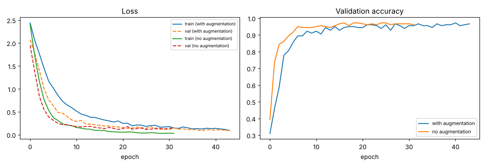
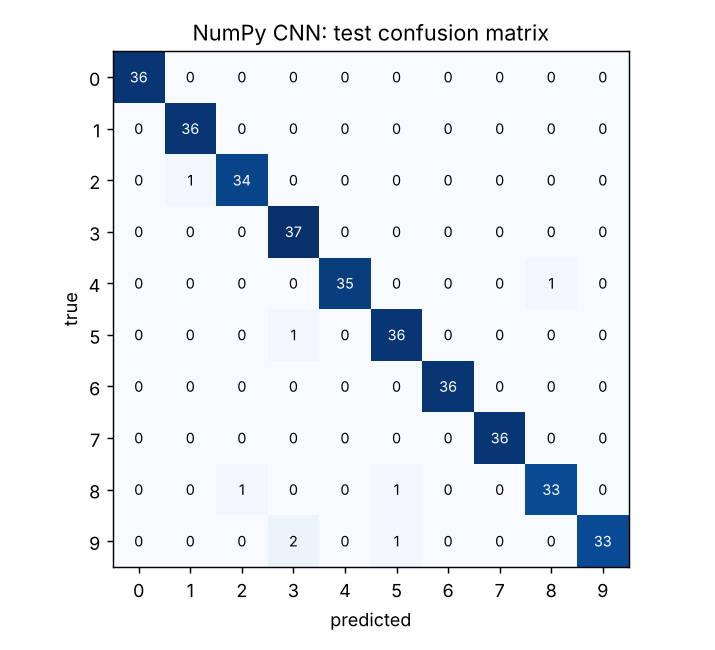
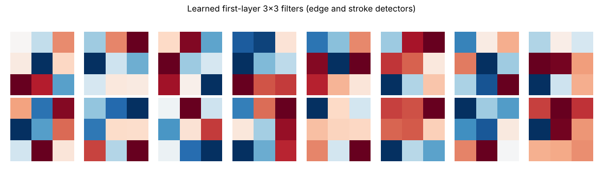
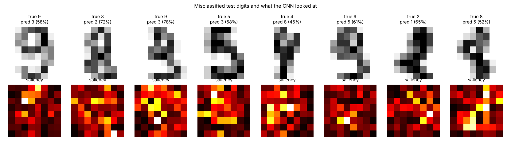
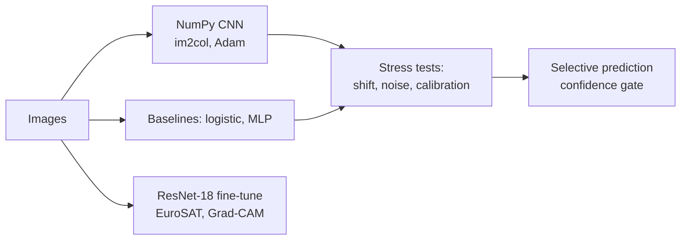

# Robust Image Classification: a NumPy CNN that keeps 95% accuracy when images shift, where simpler models fall below 50%

**[Walkthrough notebook](notebooks/walkthrough.ipynb)** · **[Colab: ResNet-18 on EuroSAT](notebooks/transfer_learning_colab.ipynb)** · **[Methods](docs/methods.md)** · **[Model card](docs/model_card.md)**

## Executive summary

- **Business question.** Image models that score 98% on clean test images can fail as soon as an image is slightly off-centre. Which model survives the conditions it will meet in deployment?
- **Answer.** All four models are within 1.5 points on clean digits, but a **one-pixel shift drops the flat models below 50%** while the CNN with shift augmentation holds **95.3%**. At a 0.9 confidence threshold, 92% of images are handled automatically with **zero errors**. It is less robust to noise (88.9%), which is reported, not hidden.
- **Recommendation.** Stress-test models on the corruptions they will meet before choosing one; route low-confidence predictions to people.
- **Tools.** NumPy (CNN written from scratch, gradient-checked) · scikit-learn · PyTorch ResNet-18 transfer learning · Grad-CAM · Streamlit


**Problem.** Image models that score 98% on a clean test set can still fail as soon as an image is slightly off-centre or noisy. This project builds a convolutional neural network **from first principles** (every forward and backward pass written in NumPy and checked against numerical gradients), then measures what actually matters before deployment: robustness, calibration and explainability. A second part applies the same ideas to real satellite photos with a pretrained **ResNet-18** in PyTorch.

**Dataset.** UCI handwritten digits: 1,797 real scans from 43 writers, 8×8 greyscale, 10 balanced classes (bundled with scikit-learn, nothing to download). Split stratified 70 / 10 / 20. Transfer learning uses **EuroSAT** (27,000 Sentinel-2 tiles, 10 land-use classes), downloaded automatically by torchvision. See [data/README.md](data/README.md).

**Approach.**
1. Implement Conv2D (via im2col), ReLU, MaxPool, Dense, Dropout, softmax cross-entropy and Adam in NumPy. Verify gradients by finite differences (relative error ≈ 1e-9).
2. Compare four models on the same split: logistic regression, an MLP, the CNN, and the CNN trained with ±1-pixel shift augmentation. Early stopping on validation loss.
3. Evaluate accuracy, macro-F1, **log loss** and **calibration (ECE)**, then stress-test on **shifted** and **noisy** copies of the test set.
4. Explain predictions with learned filters, feature maps and **saliency maps**, and analyse every error.
5. Fine-tune an ImageNet **ResNet-18** on EuroSAT with **Grad-CAM** explanations (GPU, Colab notebook provided).

## Results (digits test set, n = 360)

| Model | Accuracy | Macro-F1 | Log loss | ECE | **Shifted 1px** | Noise σ=0.2 |
|---|---|---|---|---|---|---|
| Logistic regression (pixels) | 96.7% | 0.967 | 0.184 | 0.072 | 43.1% | 93.1% |
| MLP, 128 hidden units | 97.8% | 0.978 | 0.135 | 0.014 | 47.8% | 93.1% |
| NumPy CNN | 96.4% | 0.964 | 0.084 | 0.016 | 64.7% | 92.5% |
| **NumPy CNN + shift augmentation** | **97.8%** | **0.978** | **0.051** | 0.019 | **95.3%** | 88.9% |

**What this shows**
- On clean images all four models are within 1.5 points: clean accuracy alone would not justify a CNN.
- **Move each digit by one pixel and the flat models collapse to below 50%.** They learned *where* ink is, not *what shape* it makes. Convolutions help (65%); convolutions plus augmentation hold at **95%**.
- The CNN's **log loss is 3.6× lower** than logistic regression's: it is confidently right and hesitant when wrong. In all 8 errors the true class was the runner-up, and the model was never more than 78% confident.
- **Honest trade-off:** the augmented CNN is the least robust to Gaussian noise (88.9%), because it never saw noise in training. Robustness has to be trained for one corruption at a time; noise augmentation is the next step.
- **Selective prediction:** with a 0.9 confidence threshold, 92% of test images are handled automatically with no errors, and all 8 errors are routed for human review.

<p float="left">
  
  
</p>

**Explainability.** First-layer filters learn oriented edge detectors. Saliency maps show the decision is driven by the strokes themselves, not the empty border:




**Transfer learning (EuroSAT).** `python -m vision.transfer_learning --epochs 5` fine-tunes ResNet-18 with flips, rotations, AdamW, a OneCycle schedule, label smoothing and mixed precision, and reports accuracy, macro-F1, top-3 accuracy and ECE per class. It needs a GPU, so run it in the [Colab notebook](notebooks/transfer_learning_colab.ipynb) (about 10 minutes on a free T4) and add your score here. Fine-tuned ResNets typically reach around 97–99% on EuroSAT RGB. The same script trains on any `folder/<class>/*.jpg` dataset with `--data folder --root path`.

## Demo app (Streamlit)

```bash
pip install -r requirements.txt
PYTHONPATH=src python -m vision.evaluate   # trains all models (~15 s on CPU), writes metrics, weights and figures
streamlit run app.py
```

- **Digits:** draw a digit on a canvas, pick a test image or upload a photo. You get the prediction, class probabilities, the 8×8 image the model actually sees, and a saliency map.
- **Satellite:** upload a satellite tile and get the land-use class with a Grad-CAM heat-map (after training the ResNet in Colab and copying `models/resnet18_eurosat.pt` into `models/`).
- **Model comparison:** the metrics table and all figures.

## Architecture



## Repository structure

```
├── app.py                         Streamlit demo (draw / upload / Grad-CAM)
├── src/vision/
│   ├── numpy_cnn.py               CNN layers, backprop, Adam, augmentation, training loop
│   ├── evaluate.py                baselines, metrics, robustness tests, saliency, figures
│   └── transfer_learning.py       PyTorch ResNet-18 fine-tuning + Grad-CAM
├── notebooks/
│   ├── walkthrough.ipynb          step-by-step analysis (executed, 60+ cells)
│   └── transfer_learning_colab.ipynb   GPU training on Google Colab
├── data/README.md                 datasets, splits, licences
├── models/numpy_cnn_digits.npz    trained CNN weights (108 KB)
├── reports/                       metrics.json + figures
├── docs/                          methods.md, model_card.md
├── tests/                         gradient checks, im2col, pooling, learning test (pytest)
├── requirements.txt               CPU: NumPy CNN + app
└── requirements-gpu.txt           PyTorch for transfer learning
```

## Running the tests

```bash
pytest -q        # 9 tests, including a numerical gradient check of every layer
```

## Limitations and safe use
- **Robustness is reported, not assumed.** Shift and noise results sit next to clean accuracy, including where the best model is worse.
- **Calibration and human review.** ECE is reported for every model, and a confidence threshold sends uncertain images to a person instead of guessing.
- **Explainability with caveats.** Saliency and Grad-CAM show *where* a model looked, not *why*. They are used for debugging, not as proof of correct reasoning.
- **Data representativeness.** The digits come from 43 writers; EuroSAT covers European landscapes only. Performance on other populations and regions is unknown and must be tested before use.
- **Privacy.** Handwriting can identify people. The app processes uploads in memory and stores nothing; no images are logged.
- **Intended use.** A teaching and portfolio project, not a production document-reading system. See the [model card](docs/model_card.md).

## Tech
NumPy · scikit-learn · PyTorch / torchvision · Streamlit · matplotlib / seaborn · pytest · GitHub Actions
